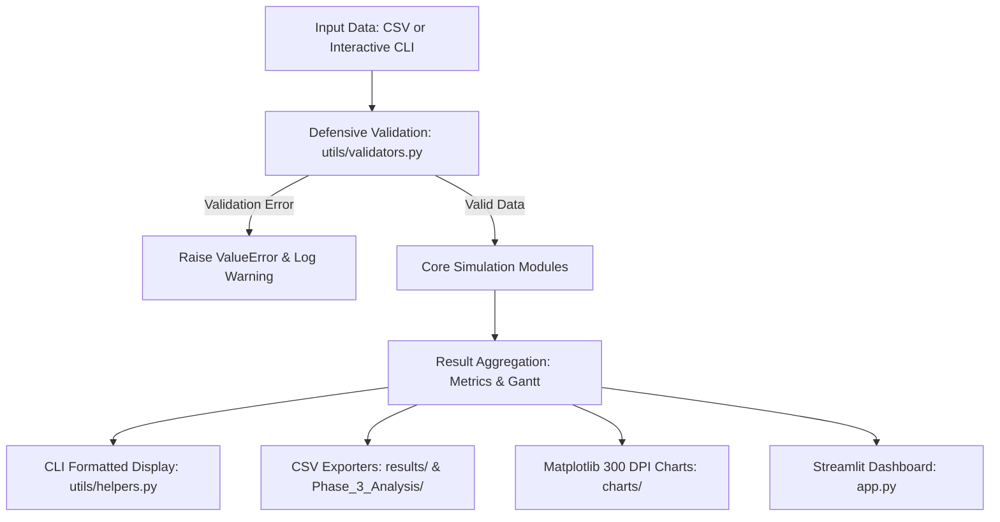

# Phase 1: Comprehensive System Architecture & Design Specification
## Operating Systems Resource Management Simulator

**Course**: Operating Systems Laboratory Capstone  
**Document**: Phase 1 Unified Design Master (`Phase_1_Design/phase1_design.md`)  
**Specification Reference**: Course Faculty Blueprint Page 10–14  
**Status**: Verified & Approved for Academic Evaluation  

---

## 1. Problem Statement & Scope

Modern multitasking computing environments require kernel subsystems that manage finite hardware resources:
1. **CPU Scheduler**: Distributes processing cycles among competing tasks to maximize throughput and minimize latency.
2. **Memory Manager**: Dynamically partitions physical memory to accommodate variable process workloads without excessive internal or external fragmentation.
3. **Deadlock Manager**: Arbitrates access to multiple non-preemptible shared resources, guaranteeing deadlock prevention or avoidance.
4. **Secondary Storage (Disk) Scheduler**: Optimizes electro-mechanical or solid-state disk arm trajectories to minimize head movement and latency.

The **OS Resource Management Simulator** delivers a rigorous, integrated academic platform in Python 3.11+ that models these subsystems deterministically, executes standard and custom workloads, generates visual telemetry, and exports reproducible empirical datasets for comparative analysis.

---

## 2. Project Objectives

1. **Subsystem Integration**: Build a unified application under a single controller (`main.py`) integrating 4 resource domains and a comparative benchmark subsystem.
2. **Algorithm Implementation**: Implement 15 foundational algorithms:
   - *CPU*: FCFS, SJF (Non-preemptive), Round Robin (Preemptive), Priority Scheduling (Non-preemptive).
   - *Memory*: First Fit, Best Fit, Worst Fit with dynamic partition splitting.
   - *Deadlock*: Dijkstra's Banker's Safety Algorithm, Need Matrix derivation, and speculative Resource-Request algorithm.
   - *Disk*: FCFS, Shortest Seek Time First (SSTF), SCAN (Elevator), C-SCAN (Circular SCAN).
3. **Mathematical Fidelity**: Implement exact metrics for Waiting Time, Turnaround Time, Response Time, CPU Utilization, External Fragmentation, and Total Head Movement.
4. **Software Engineering Excellence**: Modular decomposition, dataclass modeling, strict type annotations, structured logging (`logs/activity.log`), comprehensive test suites (115 tests, 77 test cases), and portable execution scripts (`run.sh`, `run_tests.sh`).
5. **Interactive Visualization**: Multi-panel publication-grade 300 DPI Matplotlib charts and a Streamlit presentation dashboard (`app.py`).

---

## 3. High-Level Architectural Design

The system follows a strict layered architectural pattern:

```
+-----------------------------------------------------------------------------------+
|                            PRESENTATION & CLI LAYER                               |
|       Terminal Menu (main.py)         |        Streamlit Web GUI (app.py)         |
+-----------------------------------------------------------------------------------+
                                        |
                                        v
+-----------------------------------------------------------------------------------+
|                        BENCHMARKING & REPORTING ENGINE                            |
|                          (modules/reporting.py)                                   |
|   - Multi-tier Workload Evaluation           - 300 DPI Matplotlib Chart Renderer  |
|   - CSV Metric Exporter                      - Quantum Sensitivity Scanner        |
+-----------------------------------------------------------------------------------+
                                        |
                                        v
+-----------------------------------------------------------------------------------+
|                                CORE SIMULATION LAYER                              |
|  cpu_scheduling.py  |  memory_management.py  |  deadlock.py  |  disk_scheduling.py|
+-----------------------------------------------------------------------------------+
                                        |
                                        v
+-----------------------------------------------------------------------------------+
|                             UTILITY & DEFENSIVE LAYER                             |
|    validators.py (Dataclasses)  |   logger.py (Audit)   |   helpers.py (Tables)   |
+-----------------------------------------------------------------------------------+
```

---

## 4. Subsystem Specifications

### 4.1 CPU Scheduling Subsystem (`modules/cpu_scheduling.py`)
- **Data Model**: `Process(pid, arrival_time, burst_time, priority)`
- **Metrics**:
  - $CT$: Completion Time
  - $TAT = CT - AT$
  - $WT = TAT - BT$
  - $RT = t_{\text{first\_dispatch}} - AT$
  - $\text{CPU Utilization } = \frac{\sum BT}{\max(CT) - \min(AT)} \times 100\%$
- **Execution Engine**:
  - Dispatches arriving processes based on algorithm criteria.
  - Maintains execution timeline segments `(pid, start_time, end_time)`.
  - Generates ASCII and high-resolution timeline Gantt charts.

### 4.2 Dynamic Memory Management Subsystem (`modules/memory_management.py`)
- **Partitioning Model**: Contiguous physical memory blocks with dynamic partition splitting.
- **Allocation Policies**:
  - *First Fit*: Selects first block with $size \ge request$.
  - *Best Fit*: Selects block with $\min(size - request \ge 0)$.
  - *Worst Fit*: Selects block with $\max(size - request \ge 0)$.
- **Splitting Mechanics**: When block size exceeds request, the block is divided into an allocated segment of exact request size and a remaining free block returned to the free block pool.
- **Metrics**: Allocation Success Rate (%), Total Memory Allocated (KB), Memory Utilization (%), and External Fragmentation (KB).

### 4.3 Deadlock Management Subsystem (`modules/deadlock.py`)
- **State Model**: `DeadlockState(process_ids, resource_ids, available, allocation, max_demand)`
- **Safety Algorithm**: Evaluates whether $Work = Available$ and iteratively satisfies $Need[i] \le Work$, liberating $Allocation[i]$ into $Work$.
- **Resource Request Algorithm**: Evaluates dynamic claims against $Need$ and $Available$, performs tentative state mutation, and runs safety verification before granting.

### 4.4 Disk Head Scheduling Subsystem (`modules/disk_scheduling.py`)
- **Parameters**: Cylinder requests sequence, initial head position, total cylinder range $[0, C-1]$, and initial direction.
- **Algorithms**: FCFS, SSTF (greedy closest seek), SCAN (sweeps to boundary $C-1$ before reversing), C-SCAN (sweeps to boundary, jumps to cylinder 0 without servicing, and continues in original direction).
- **Metrics**: Total Head Movement (cylinders), Average Seek Distance (cylinders/request), and Trajectory Path.

---

## 5. Data Flow & Verification Pipeline



---

## 6. Phase Acceptance Criteria

| Subsystem | Requirement | Pass Criteria | Status |
| :--- | :--- | :--- | :--- |
| **CPU Scheduling** | All 4 algorithms compute exact metrics | FCFS, SJF, RR, Priority match analytical models | Verified |
| **Memory Management** | Dynamic splitting & fragmentation tracking | Best Fit 100% allocation on preset; First Fit reports 959 KB ExtFrag | Verified |
| **Deadlock Avoidance**| Banker's safe sequence & request check | Canonical sequence `<P1, P3, P0, P2, P4>` generated; safe requests granted | Verified |
| **Disk Scheduling** | Track seek distance & elevator trajectory | SSTF services in 236 cyl; SCAN in 331 cyl; C-SCAN in 382 cyl | Verified |
| **Test Suite** | Comprehensive automated validation | 115 unittests pass; 77 test cases in matrix | Verified |
| **Presentation** | Interactive terminal & Streamlit dashboard | Both interfaces functional with live telemetry | Verified |
