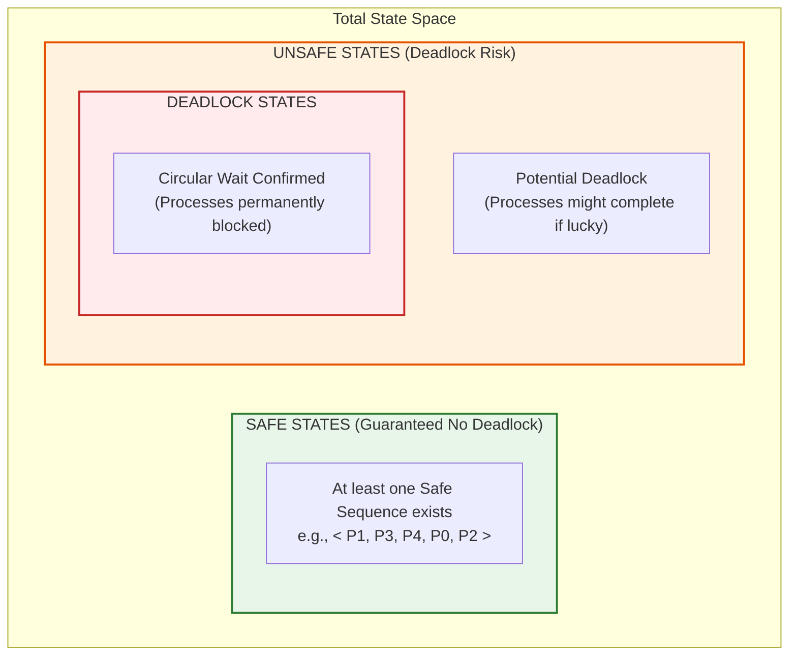
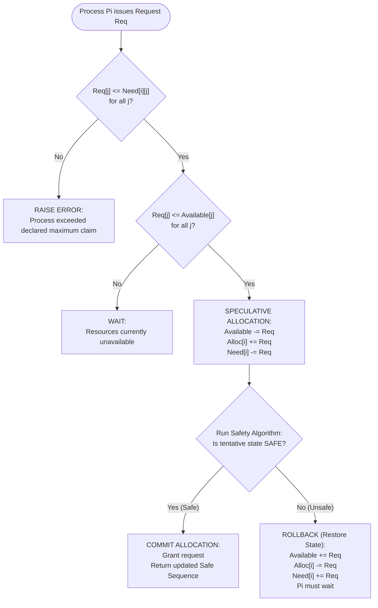

# Module 3 — Deadlock Management (Banker's Algorithm)

**Subsystem**: Deadlock Avoidance and Resource Allocation  
**Implementation**: [`modules/deadlock.py`](file:///C:/Users/rpsra/Downloads/Operating-Systems-Lab/modules/deadlock.py)  
**Test Suite**: [`tests/test_deadlock.py`](file:///C:/Users/rpsra/Downloads/Operating-Systems-Lab/tests/test_deadlock.py) (22 unit tests)  
**Interactive Entry Point**: Option 3 in [`main.py`](file:///C:/Users/rpsra/Downloads/Operating-Systems-Lab/main.py)  

---

## 1. Executive Summary & Problem Formulation

In a multi-programming operating system, multiple concurrent processes compete for a finite set of shared, non-preemptible resources (e.g., CPU cores, memory partitions, I/O channels, printer locks, database semaphores). A **deadlock** occurs when a set of processes are blocked because each process is holding resources and waiting to acquire additional resources held by other processes in the same set.

Deadlock handling strategies span four classical paradigms:
1. **Deadlock Prevention**: Constrain resource requests by invalidating at least one of the four necessary Coffman conditions at system design time.
2. **Deadlock Avoidance**: Dynamically evaluate every resource request before granting it. The operating system maintains global knowledge of maximum claims and grants a request if and only if the resulting system state remains **safe** (Dijkstra's Banker's Algorithm).
3. **Deadlock Detection and Recovery**: Allow resource allocation without restriction; periodically run detection algorithms (Wait-For-Graphs) and recover via process termination or resource preemption.
4. **Deadlock Ignorance (Ostrich Algorithm)**: Ignore the problem entirely under the assumption that deadlocks occur rarely (common in general-purpose OS kernels like Linux and Windows).

This module implements **Dijkstra's Banker's Algorithm** (E. W. Dijkstra, 1965) for multi-instance resource types, modeling safe sequence generation, need matrix computation, and speculative resource-request evaluation with full rollback protection.

---

## 2. Necessary Conditions for Deadlock (Coffman Conditions)

A system can enter a deadlock state if and only if all four of the following conditions hold simultaneously:

1. **Mutual Exclusion**: At least one resource must be held in a non-shareable mode (only one process can use the resource instance at any given time).
2. **Hold and Wait**: A process must currently hold at least one resource and simultaneously request additional resources currently held by other processes.
3. **No Preemption**: Resources cannot be forcibly confiscated from a process holding them; they can only be released voluntarily after the process has finished its task.
4. **Circular Wait**: A closed chain of processes $\{P_0, P_1, \dots, P_n\}$ exists such that $P_0$ is waiting for a resource held by $P_1$, $P_1$ is waiting for $P_2$, $\dots$, and $P_n$ is waiting for $P_0$.

Banker's Algorithm avoids deadlock by ensuring that the system never enters an **unsafe state**, thereby preventing a Circular Wait condition from ever materializing.

---

## 3. Mathematical State Model

Let $n$ denote the number of active processes $\{P_0, P_1, \dots, P_{n-1}\}$ and $m$ denote the number of distinct resource types $\{R_0, R_1, \dots, R_{m-1}\}$.

### 3.1 Vectors and Matrices

1. **Available Vector** ($\mathbf{A} \in \mathbb{N}^m$):
   $A[j]$ represents the number of available, unallocated instances of resource type $R_j$.

2. **Max Demand Matrix** ($\mathbf{M} \in \mathbb{N}^{n \times m}$):
   $M[i][j]$ defines the maximum number of instances of resource $R_j$ that process $P_i$ may ever claim during its entire lifecycle.

3. **Allocation Matrix** ($\mathbf{C} \in \mathbb{N}^{n \times m}$):
   $C[i][j]$ represents the number of instances of resource $R_j$ currently allocated and held by process $P_i$.

4. **Need Matrix** ($\mathbf{N} \in \mathbb{N}^{n \times m}$):
   $N[i][j]$ represents the remaining instances of resource $R_j$ that process $P_i$ may require to finish execution:
   $$\mathbf{N}[i][j] = \mathbf{M}[i][j] - \mathbf{C}[i][j]$$

5. **Total System Capacity Vector** ($\mathbf{E} \in \mathbb{N}^m$):
   The conservation of resources requires that for every resource type $R_j$:
   $$E[j] = A[j] + \sum_{i=0}^{n-1} C[i][j]$$

### 3.2 System State Invariants

For a system state to be valid, the following physical bounds must be satisfied:
$$\forall i \in [0, n-1], \forall j \in [0, m-1]: \quad 0 \le C[i][j] \le M[i][j]$$
$$\forall j \in [0, m-1]: \quad A[j] \ge 0$$
$$\forall i \in [0, n-1], \forall j \in [0, m-1]: \quad N[i][j] \ge 0$$

---

## 4. Safe State vs. Unsafe State vs. Deadlock

The state space of a resource-allocating operating system is partitioned into three nested domains:



- **Safe State**: A state is safe if there exists an ordered execution sequence $\langle P_{\pi(0)}, P_{\pi(1)}, \dots, P_{\pi(n-1)} \rangle$ such that for each process $P_{\pi(i)}$, its maximum remaining need $N[\pi(i)]$ can be satisfied by the currently available resources plus the resources already held by all preceding processes:
  $$N[\pi(i)] \le A + \sum_{k=0}^{i-1} C[\pi(k)]$$
- **Unsafe State**: A state where **no complete safe sequence exists**. An unsafe state is **NOT** synonymous with a deadlock; rather, an unsafe state signifies that the OS can no longer guarantee the prevention of deadlock if all processes simultaneously exercise their declared maximum claims.
- **Deadlock State**: A subset of unsafe states where processes are actually and permanently trapped in a circular wait.

---

## 5. Core Algorithmic Specifications

### 5.1 Safety Algorithm (Dijkstra)

The safety algorithm determines whether the system is in a safe state and returns a valid dispatch sequence:

```text
Algorithm BankerSafety(State):
    Input: Available A[m], Allocation C[n][m], Need N[n][m], Process IDs
    Output: (is_safe: bool, safe_sequence: list[str])

    1. Initialize:
       Work = copy(A)              // Work vector of length m
       Finish = [False] * n        // Finish boolean vector of length n
       SafeSeq = []

    2. Loop:
       Find an index i such that:
           Finish[i] == False and
           Need[i][j] <= Work[j] for all j in 0..m-1

       If such an i exists:
           Work[j] = Work[j] + Allocation[i][j] for all j in 0..m-1
           Finish[i] = True
           SafeSeq.append(ProcessIDs[i])
           Repeat Step 2

       If no such i exists:
           If len(SafeSeq) == n:
               return (True, SafeSeq)
           Else:
               return (False, [])
```

#### Complexity Analysis
- **Time Complexity**: Finding an eligible process requires examining up to $n$ unfinished processes, each checking $m$ resource components ($\mathcal{O}(m \cdot n)$). In the worst case, each step finishes exactly one process, repeating $n$ times. The total worst-case time complexity is:
  $$\mathcal{T}(n, m) = \mathcal{O}(m \cdot n^2)$$
- **Space Complexity**: The auxiliary `Work` vector takes $\mathcal{O}(m)$ space, and the `Finish` vector takes $\mathcal{O}(n)$ space. Overall auxiliary space complexity is $\mathcal{O}(m + n)$.

---

### 5.2 Resource-Request Algorithm

When a process $P_i$ makes a dynamic request vector $\mathbf{Req}_i \in \mathbb{N}^m$:



#### Invariant Enforcement
1. **Zero Caller Mutation on Denial**: If a request violates claims, exceeds available resources, or leads to an unsafe state, the caller's matrices are guaranteed $100\%$ untouched.
2. **Defensive Deep Copying**: Tentative state evaluations run on detached memory copies, preventing state corruption in multithreaded or speculative contexts.

---

## 6. Canonical Blueprint Walkthrough

### 6.1 Baseline Configuration
- **Processes**: $n = 5$ ($P_0, P_1, P_2, P_3, P_4$)
- **Resource Types**: $m = 3$ ($A, B, C$)
- **Total System Instances**: $E = [10, 5, 7]$
- **Available**: $A = [3, 3, 2]$

$$\mathbf{Allocation} = \begin{bmatrix}
0 & 1 & 0 \\
2 & 0 & 0 \\
3 & 0 & 2 \\
2 & 1 & 1 \\
0 & 0 & 2
\end{bmatrix}, \quad
\mathbf{Max} = \begin{bmatrix}
7 & 5 & 3 \\
3 & 2 & 2 \\
9 & 0 & 2 \\
2 & 2 & 2 \\
4 & 3 & 3
\end{bmatrix}, \quad
\mathbf{Need} = \begin{bmatrix}
7 & 4 & 3 \\
1 & 2 & 2 \\
6 & 0 & 0 \\
0 & 1 & 1 \\
4 & 3 & 1
\end{bmatrix}$$

$$\text{Sum Allocated} = [7, 2, 5], \quad \mathbf{Available} = [10 - 7, 5 - 2, 7 - 5] = [3, 3, 2]$$

### 6.2 Step-by-Step Safety Trace

| Step | Work Vector | Eligible Processes ($\text{Need} \le \text{Work}$) | Selected Process | Released Allocation | New Work Vector | Finish Status |
|:---:|:---:|:---:|:---:|:---:|:---:|:---:|
| **0** | $[3, 3, 2]$ | Only $P_1$ ($\text{Need}_1 = [1, 2, 2] \le [3, 3, 2]$) | **$P_1$** | $[2, 0, 0]$ | $[5, 3, 2]$ | $[F, T, F, F, F]$ |
| **1** | $[5, 3, 2]$ | $P_3$ ($\text{Need}_3 = [0, 1, 1] \le [5, 3, 2]$) | **$P_3$** | $[2, 1, 1]$ | $[7, 4, 3]$ | $[F, T, F, T, F]$ |
| **2** | $[7, 4, 3]$ | $P_0$ ($[7, 4, 3]$) and $P_4$ ($[4, 3, 1]$) | **$P_4$** | $[0, 0, 2]$ | $[7, 4, 5]$ | $[F, T, F, T, T]$ |
| **3** | $[7, 4, 5]$ | $P_0$ ($[7, 4, 3]$) and $P_2$ ($[6, 0, 0]$) | **$P_0$** | $[0, 1, 0]$ | $[7, 5, 5]$ | $[T, T, F, T, T]$ |
| **4** | $[7, 5, 5]$ | $P_2$ ($\text{Need}_2 = [6, 0, 0] \le [7, 5, 5]$) | **$P_2$** | $[3, 0, 2]$ | $[10, 5, 7]$ | $[T, T, T, T, T]$ |

**Result**: Complete safe sequence generated:
$$\langle P_1, P_3, P_4, P_0, P_2 \rangle$$
*(Note: $\langle P_1, P_3, P_0, P_2, P_4 \rangle$ is an equally valid safe sequence).*

---

## 7. Dynamic Request Case Studies

### Case 1: Safe Request Granted
- **Request**: $P_1$ requests $[1, 0, 2]$.
- **Condition 1**: $[1, 0, 2] \le \text{Need}_1 [1, 2, 2] \implies \text{True}$.
- **Condition 2**: $[1, 0, 2] \le \text{Available} [3, 3, 2] \implies \text{True}$.
- **Tentative State**:
  $$\text{Available} = [2, 3, 0], \quad \text{Alloc}_1 = [3, 0, 2], \quad \text{Need}_1 = [0, 2, 0]$$
- **Safety Evaluation**:
  - $P_1$ can finish ($\text{Need}_1 = [0, 2, 0] \le [2, 3, 0]$) $\to \text{Work} = [2, 3, 0] + [3, 0, 2] = [5, 3, 2]$.
  - $P_3$ can finish $\to \text{Work} = [7, 4, 3]$.
  - $P_4 \to P_0 \to P_2$ complete safely.
- **Outcome**: **Granted**. State updated.

### Case 2: Unsafe Request Denied (Rollback Triggered)
- **Request**: $P_4$ requests $[3, 3, 0]$.
- **Condition 1**: $[3, 3, 0] \le \text{Need}_4 [4, 3, 1] \implies \text{True}$.
- **Condition 2**: $[3, 3, 0] \le \text{Available} [3, 3, 2] \implies \text{True}$.
- **Tentative State**:
  $$\text{Available} = [0, 0, 2], \quad \text{Alloc}_4 = [3, 3, 2], \quad \text{Need}_4 = [1, 0, 1]$$
- **Safety Evaluation**:
  - Check $P_0$: $\text{Need}_0 = [7, 4, 3] > [0, 0, 2]$ (Cannot run).
  - Check $P_1$: $\text{Need}_1 = [1, 2, 2] > [0, 0, 2]$ (Cannot run).
  - Check $P_2$: $\text{Need}_2 = [6, 0, 0] > [0, 0, 2]$ (Cannot run).
  - Check $P_3$: $\text{Need}_3 = [0, 1, 1] > [0, 0, 2]$ (Cannot run).
  - Check $P_4$: $\text{Need}_4 = [1, 0, 1] > [0, 0, 2]$ (Cannot run).
  - **Deadlock detected**: No process can execute. Tentative state is **UNSAFE**.
- **Outcome**: **Denied**. State rolled back. $P_4$ must wait.

### Case 3: Maximum Claim Exceeded
- **Request**: $P_1$ requests $[2, 0, 0]$.
- **Condition 1**: $[2, 0, 0] \le \text{Need}_1 [1, 2, 2] \implies \mathbf{False}$ ($2 > 1$ for Resource $A$).
- **Outcome**: **Immediate Error**. Process denied with maximum claim violation.

### Case 4: Insufficient Current Resources
- **Request**: $P_0$ requests $[4, 0, 0]$.
- **Condition 1**: $[4, 0, 0] \le \text{Need}_0 [7, 4, 3] \implies \text{True}$.
- **Condition 2**: $[4, 0, 0] \le \text{Available} [3, 3, 2] \implies \mathbf{False}$ ($4 > 3$ for Resource $A$).
- **Outcome**: **Wait**. Process blocked until resources are released.

---

## 8. Defensive Verification & Edge Handling

The module provides rigorous defensive boundary checks enforced in both [`utils/validators.py`](file:///C:/Users/rpsra/Downloads/Operating-Systems-Lab/utils/validators.py) and [`modules/deadlock.py`](file:///C:/Users/rpsra/Downloads/Operating-Systems-Lab/modules/deadlock.py):

| Test Condition | Failure Type | Defensive Response |
|:---|:---|:---|
| Negative numbers | `Allocation[i][j] < 0` or `Req[j] < 0` | Raises `ValueError` with offending coordinate |
| Allocation $>$ Max Demand | `Alloc[i][j] > Max[i][j]` | Raises `ValueError("Allocation exceeds Max Demand")` |
| Row length mismatch | Row length $\ne m$ | Raises `ValueError("Dimension mismatch")` |
| Process count mismatch | $\text{len}(\text{Allocation}) \ne \text{len}(\text{Max})$ | Raises `ValueError("Row count mismatch")` |
| Empty process / resource set | $n = 0$ or $m = 0$ | Raises `ValueError("Matrices cannot be empty")` |
| Non-existent PID | $P_{999}$ requests resource | Returns `(False, "Process 'P999' not found", [])` |

---

## 9. Faculty Viva Defense Guide

> **Q1: Why is an unsafe state not necessarily a deadlocked state?**  
> **A**: An unsafe state means the operating system can no longer guarantee avoidance of deadlock under worst-case demands (i.e., if every process simultaneously requests its maximum declared claim). However, if processes in practice do not request their full maximum claims or release resources early, the system may run to completion without deadlocking. Thus, Deadlock $\subset$ Unsafe, but Unsafe $\not\subseteq$ Deadlock.

> **Q2: What is the computational complexity of the Banker's safety algorithm?**  
> **A**: In a system with $n$ processes and $m$ resource types, checking if a process can run takes $\mathcal{O}(m)$ comparisons. We search among up to $n$ unfinished processes. In the worst case, each scan finds exactly one process to finish, requiring $n$ iterations. Hence, the overall time complexity is $\mathcal{O}(m \cdot n^2)$. The space complexity is $\mathcal{O}(m + n)$ for the `Work` and `Finish` tracking structures.

> **Q3: What are the primary practical limitations of Banker's Algorithm in modern commercial OS kernels?**  
> **A**: 
> 1. Processes must know and declare their maximum resource claims in advance, which is impossible in general-purpose desktop/server workloads.
> 2. The number of active processes ($n$) and resource instances ($m$) is assumed constant, whereas modern kernels dynamically spawn processes and hot-plug hardware.
> 3. Evaluating $\mathcal{O}(m \cdot n^2)$ safety checks on every syscall allocation imposes unacceptable scheduler latency.

> **Q4: How does Banker's algorithm maintain caller data immutability during speculative requests?**  
> **A**: The engine performs tentative allocations on an isolated `copy.deepcopy(state)`. The safety check runs strictly against this candidate state. Only if the state remains provably safe is the official state updated; otherwise, the tentative state is discarded, ensuring the caller's active matrices remain completely unmutated.

> **Q5: Can there be multiple valid safe sequences for a single system state?**  
> **A**: Yes. Whenever two or more unfinished processes simultaneously satisfy $\text{Need}_i \le \text{Work}$, branching order determines which process executes first. Regardless of which candidate finishes first, releasing its resources expands the `Work` vector monotonically ($\text{Work}' = \text{Work} + \text{Alloc}_i \ge \text{Work}$), ensuring that the alternative process remains eligible in subsequent steps.

> **Q6: Why is the Need matrix updated whenever a process receives resources dynamically?**  
> **A**: The Need matrix reflects remaining potential claim: $\text{Need}_i = \text{Max}_i - \text{Alloc}_i$. When $\text{Alloc}_i$ increases by $\text{Req}_i$, the remaining maximum resources that $P_i$ may request decreases by $\text{Req}_i$. Failing to decrement $\text{Need}_i$ would falsely inflate $P_i$'s future claims, potentially causing false-negative safety rejections.
