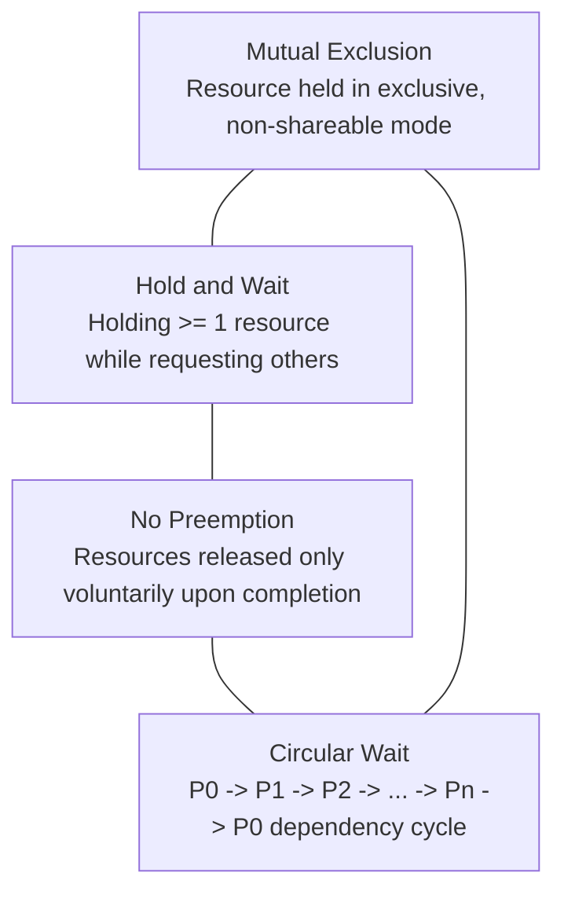

# Viva Voce Comprehensive Preparation Guide
## OS Resource Management Simulator — Academic Standards & Theoretical Defense

**Document Purpose**: Definitive oral examination (viva voce) handbook for faculty evaluation. Contains rigorous mathematical proofs, architectural justifications, edge case analyses, and algorithmic time/space complexity matrices.

---

## Question 1: FCFS vs. SJF Differences & Mathematical Proof of Optimality

### 1.1 Fundamental Algorithmic Differences
| Dimension | First-Come First-Served (FCFS) | Shortest Job First (SJF - Non-Preemptive) |
| :--- | :--- | :--- |
| **Selection Criterion** | Earliest Arrival Time ($AT$) | Smallest Burst Time ($BT$) among ready processes |
| **Preemption Mode** | Non-preemptive | Non-preemptive |
| **Convoy Effect** | Severe vulnerability: short I/O bound jobs wait behind long CPU-bound jobs | Completely eliminated |
| **Starvation Risk** | Zero (guaranteed FIFO service order) | High: stream of short jobs continuously starves long jobs |
| **Implementation Overhead** | Minimal ($O(1)$ queue operations) | Higher ($O(\log n)$ priority queue or sorting) |

### 1.2 The Convoy Effect Explained
In FCFS, if a CPU-heavy process with burst time $BT=50$ arrives at $t=0$, followed by three interactive processes with $BT=1, 2, 1$ arriving at $t=1$, the interactive processes suffer waiting times of $49, 50, 52$ ms respectively. The average waiting time balloons to $37.75$ ms. In contrast, SJF would dispatch the short jobs first (once ready), collapsing average waiting time.

### 1.3 Formal Mathematical Proof: Optimality of SJF
**Theorem**: For any set of $n$ processes simultaneously available in the ready queue at $t=0$ with known burst times $\{b_1, b_2, \dots, b_n\}$, non-preemptive Shortest Job First (ordering processes such that $b_{\pi(1)} \le b_{\pi(2)} \le \dots \le b_{\pi(n)}$) minimizes the average waiting time $\overline{WT}$.

**Proof by Exchange Argument (Rearrangement Inequality)**:
Let $\pi = (\pi_1, \pi_2, \dots, \pi_n)$ be an arbitrary scheduling permutation of the $n$ processes.
Under non-preemptive dispatch, process $\pi_k$ begins execution after all preceding processes $\pi_1, \dots, \pi_{k-1}$ complete.
Therefore, the waiting time of the $k$-th process in sequence is:
$$W_{\pi_k} = \sum_{j=1}^{k-1} b_{\pi_j}$$

The total waiting time across all $n$ processes is:
$$\sum_{k=1}^n W_{\pi_k} = \sum_{k=1}^n \sum_{j=1}^{k-1} b_{\pi_j}$$

Interchanging summation indices, the burst time $b_{\pi_j}$ of process $\pi_j$ is added to the waiting time of every subsequent process $\pi_{j+1}, \pi_{j+2}, \dots, \pi_n$. Since there are $(n - j)$ processes after $\pi_j$, the burst time $b_{\pi_j}$ appears exactly $(n - j)$ times in the sum:
$$\sum_{k=1}^n W_{\pi_k} = \sum_{j=1}^n (n - j) b_{\pi_j} = (n-1)b_{\pi_1} + (n-2)b_{\pi_2} + \dots + 1 \cdot b_{\pi_{n-1}} + 0 \cdot b_{\pi_n}$$

The average waiting time is:
$$\overline{WT} = \frac{1}{n} \sum_{j=1}^n (n - j) b_{\pi_j}$$

The coefficients $c_j = (n - j)$ form a strictly decreasing sequence:
$$c_1 > c_2 > \dots > c_n \quad \text{where } c_1 = n-1, \, c_n = 0$$

According to the **Rearrangement Inequality**, the dot product $\sum_{j=1}^n c_j b_{\pi_j}$ between a strictly decreasing sequence $\{c_j\}$ and a permutation of $\{b_i\}$ is **minimized** if and only if the sequences are ordered oppositely. Since $\{c_j\}$ is strictly decreasing, $\{b_{\pi_j}\}$ must be ordered monotonically increasing:
$$b_{\pi_1} \le b_{\pi_2} \le b_{\pi_3} \le \dots \le b_{\pi_n}$$

**Direct Inversion Check**:
Suppose there exists an inversion in schedule $\pi$ where $b_{\pi_i} > b_{\pi_{i+1}}$. Swapping these two adjacent processes changes the total waiting time by:
$$\Delta \sum W = \left[(n-i)b_{\pi_{i+1}} + (n-(i+1))b_{\pi_i}\right] - \left[(n-i)b_{\pi_i} + (n-(i+1))b_{\pi_{i+1}}\right]$$
$$\Delta \sum W = b_{\pi_{i+1}} - b_{\pi_i} < 0$$
Since $\Delta \sum W < 0$, swapping strictly decreases total and average waiting time. Thus, any schedule not ordered by SJF is sub-optimal. $\blacksquare$

---

## Question 2: Why Round Robin is Useful & Quantum Selection Trade-offs

### 2.1 Why Round Robin is Critical for Modern Systems
Batch algorithms (FCFS, SJF, Priority) optimize for throughput or average waiting time but fail in interactive time-sharing environments. An interactive text editor or terminal command cannot tolerate waiting behind an 8-minute computational compile job.

Round Robin (RR) introduces preemptive time-slicing via timer interrupts:
- **Fairness**: Every active process receives an equal share of the CPU ($\frac{1}{n}$ fraction).
- **Bounded Response Time**: For $n$ processes and time quantum $q$, no process waits longer than $(n - 1)q$ time units before being allocated CPU time.
- **Empirical Demonstration**: In our project benchmark:
  - FCFS Response Time: $5.75$ ms
  - SJF Response Time: $4.00$ ms
  - **Round Robin ($q=2$) Response Time**: **$2.00$ ms** (a 65.2% reduction in initial latency).

### 2.2 Quantum Selection Trade-offs
Let $q$ denote the time quantum and $\Delta$ denote the context switch overhead (saving CPU registers, updating PCB, invalidating cache lines, restoring new process state).

```
  Large Quantum (q -> inf)            Balanced Quantum (q optimal)            Small Quantum (q -> 0)
<---------------------------------------------------|--------------------------------------------------->
• Degenerates into FCFS               • 80% of CPU bursts < q                • Processor Sharing Illusion
• Response time degrades              • Context switch overhead < 1%         • Thrashing in Context Switches
• High latency for short jobs         • Low response time maintained         • CPU Utilization drops to:
                                                                               q / (q + delta) -> 0%
```

1. **Extreme Case 1: Quantum $q \to \infty$**:
   Every process completes its entire burst in its first quantum. Round Robin becomes functionally identical to FCFS. Interactive responsiveness is lost.
2. **Extreme Case 2: Quantum $q \to 0$ (Processor Sharing)**:
   While processes appear to run concurrently on separate slower CPUs of speed $1/n$, the CPU spends nearly all clock cycles in kernel mode context switching. The effective utilization is $\eta = \frac{q}{q + \Delta}$. As $q \to 0$, $\eta \to 0$.
3. **Faculty Blueprint Guideline (Silberschatz Rule)**:
   The time quantum should be chosen such that **approximately 80% of CPU bursts are shorter than $q$**, keeping context switch overhead well below 1% of the quantum duration.

---

## Question 3: Distinguishing Internal vs. External Fragmentation

### 3.1 Structural Comparison
```
INTERNAL FRAGMENTATION (Fixed Partitioning / Paging)    EXTERNAL FRAGMENTATION (Dynamic Variable Partitions)
+------------------------------------+                 +------------------+  +------------------+
| Allocated Block (500 KB)           |                 | Block 1 (Free)   |  | Process P1       |
| +-------------------------+--------+                 | 200 KB           |  | Allocated 300 KB |
| | Process Request (420 KB)| Unused |                 +------------------+  +------------------+
| |                         | 80 KB  |                 | Block 2 (Free)   |  Incoming Request:  |
| +-------------------------+--------+                 | 250 KB           |  400 KB             |
| Unusable by ANY other process      |                 +------------------+  Total Free: 450 KB |
+------------------------------------+                 Contiguous Max: 250 KB -> FAILS!         |
```

| Metric | Internal Fragmentation | External Fragmentation |
| :--- | :--- | :--- |
| **Definition** | Unused memory *inside* an allocated block or partition. | Free memory available in aggregate *across* blocks, but non-contiguous. |
| **Typical Context** | Fixed partitioning, Paging (last page slack), Slab allocators. | Dynamic contiguous variable partitioning (heap memory, segmentation). |
| **Quantification** | $\sum_{i} (\text{BlockSize}_i - \text{AllocatedPayload}_i)$ | When request $R$ fails: $\sum_{b \in Free} Size(b)$ if $\sum Size(b) \ge R$. |
| **Simulator Behavior** | **0 KB** (due to Dynamic Partition Splitting returning exact remainder). | Observed in First Fit and Worst Fit ($959$ KB external fragmentation). |
| **Resolution Strategy** | Reduce page size; match allocations to power-of-two slab sizes. | Memory Compaction (defragmentation), Non-contiguous allocation (Paging). |

### 3.2 Simulator Benchmark Case Study
In Module 2 benchmarks with blocks `[100, 500, 200, 300, 600]` KB and requests `P1: 212, P2: 417, P3: 112, P4: 426`:
- **Best Fit**: Successfully allocated all 4 processes ($100\%$ success, $1167$ KB placed, External Frag = $0$ KB).
- **First Fit**: Allocated P1, P2, P3, but **failed on P4 (426 KB)**. Free blocks remaining were `100, 200, 288, 371` KB (Total free = $959$ KB). Despite $959 \text{ KB} > 426 \text{ KB}$, no single partition was large enough. External Fragmentation was exactly **$959$ KB**.

---

## Question 4: Definition and 4 Coffman Conditions of Deadlock

### 4.1 Formal Definition of Deadlock
A system state is in **deadlock** if and only if there exists a set of concurrent processes $S = \{P_1, P_2, \dots, P_k\}$ such that every process $P_i \in S$ is waiting for an event (specifically, the release of a resource) that can only be triggered by another process $P_j \in S$.

### 4.2 The 4 Coffman Conditions (Coffman et al., 1971)
Deadlock can arise if and only if **all four** of the following conditions hold simultaneously in the system:



1. **Mutual Exclusion**: At least one resource must be held in a non-shareable mode (only one process at a time can use the resource).
   - *Prevention Strategy*: Make resources shareable (e.g., read-only file locks).
2. **Hold and Wait**: A process must currently hold at least one resource while waiting to acquire additional resources held by other processes.
   - *Prevention Strategy*: Require processes to request all required resources at once prior to execution, or release current holdings before making new requests.
3. **No Preemption**: Resources cannot be forcibly seized from a process; they can only be released voluntarily after the holding process has finished its task.
   - *Prevention Strategy*: If a process holding resources is denied an additional request, its current allocations are preempted and placed in a wait state.
4. **Circular Wait**: A closed chain of processes $\{P_0, P_1, \dots, P_n\}$ exists such that $P_0$ is waiting for a resource held by $P_1$, $P_1$ is waiting for $P_2$, ..., and $P_n$ is waiting for $P_0$.
   - *Prevention Strategy*: Impose a strict global linear ordering on all resource types ($F: R \to \mathbb{N}$). Processes may only request resources in strictly increasing order ($F(R_j) > F(R_i)$).

---

## Question 5: Step-by-Step Mechanics of Dijkstra's Banker's Algorithm

### 5.1 System State Representation
For $n$ processes and $m$ resource types:
- **Available** $[m]$: Vector of available instances per resource type.
- **Max** $[n \times m]$: Maximum demand matrix of each process.
- **Allocation** $[n \times m]$: Instances currently allocated to each process.
- **Need** $[n \times m]$: Remaining resource claim derived as:
  $$Need[i][j] = Max[i][j] - Allocation[i][j] \quad \forall i, j$$

### 5.2 The Safety Algorithm (Step-by-Step)
1. **Initialization**:
   - Let $Work = Available$ (vector copy of size $m$).
   - Let $Finish[i] = False \quad \forall i \in \{0, 1, \dots, n-1\}$.
2. **Find an Eligible Process**:
   Find an index $i$ such that:
   $$Finish[i] == False \quad \text{and} \quad Need[i][j] \le Work[j] \quad \forall j \in \{0, \dots, m-1\}$$
3. **Simulate Completion & Deallocation**:
   If such an $i$ exists:
   $$Work = Work + Allocation[i]$$
   $$Finish[i] = True$$
   Append $P_i$ to $SafeSequence$. Repeat Step 2.
4. **State Evaluation**:
   If $Finish[i] == True$ for all $i$, the system is in a **SAFE state**, and $SafeSequence$ guarantees deadlock-free execution. If any process has $Finish[i] == False$, the system is in an **UNSAFE state**.

### 5.3 The Resource-Request Algorithm
When process $P_i$ issues a request vector $Request_i$:
1. If $Request_i[j] > Need[i][j]$ for any $j \implies$ **Raise Error** (Process exceeded maximum claim).
2. If $Request_i[j] > Available[j]$ for any $j \implies$ $P_i$ must **wait** (Resources unavailable).
3. **Speculative Allocation**:
   $$Available = Available - Request_i$$
   $$Allocation[i] = Allocation[i] + Request_i$$
   $$Need[i] = Need[i] - Request_i$$
4. Run the Safety Algorithm on the tentative state:
   - If **SAFE** $\to$ Grant resources permanently.
   - If **UNSAFE** $\to$ Roll back state vectors, restore previous allocations, and force $P_i$ to wait.

---

## Question 6: SCAN vs. SSTF Differences and Elevator Starvation Trade-offs

### 6.1 Mechanical Differences
- **SSTF (Shortest Seek Time First)**:
  Greedy localized optimization. At each step, moves the disk head to whichever queued cylinder has the smallest absolute distance:
  $$\text{Next Target} = \arg\min_{c \in Requests} |c - \text{CurrentHead}|$$
- **SCAN (Elevator Algorithm)**:
  Directional sweep. Moves continuously in one direction (e.g., towards cylinder $199$), servicing all pending requests encountered along the trajectory. When it reaches the disk boundary, it reverses direction and sweeps back toward cylinder $0$, servicing requests on the return pass.

### 6.2 Comparison & Starvation Trade-off
| Criterion | SSTF | SCAN (Elevator) |
| :--- | :--- | :--- |
| **Total Head Movement** | Lowest in localized clusters ($236$ cyl in benchmark) | Moderate seek distance ($331$ cyl in benchmark) |
| **Arm Stickiness / Starvation** | **Severe**: High request density at center starves outer cylinders indefinitely. | **Zero**: Head continuously traverses the entire surface, servicing all cylinders. |
| **Seek Time Variance ($\sigma^2$)** | High variance: some requests serviced instantly, others wait indefinitely. | Low variance: maximum delay is bounded by $2 \times \text{TotalCylinders}$. |
| **Fairness** | Unfair to boundary requests | High fairness across all disk tracks |

**Trade-off Summary**: While SSTF reduces average seek distance by $28.7\%$ compared to SCAN in our baseline workload, it is unacceptable for production operating systems without starvation guards (such as aged requests). SCAN guarantees deterministic upper bounds on latency.

---

## Question 7: Architectural Justification for Python & Standard Library Choice

### 7.1 Language Selection Justification
1. **Academic Clarity & Expressiveness**: Python enables high-level mathematical abstractions without pointer arithmetic or memory leak vulnerabilities obscuring core operating system logic.
2. **Built-in Arbitrary Precision**: Handles arbitrarily large process workloads and resource vectors without integer overflow edge cases.
3. **Native Typing & Modern OOP**: Python 3.10/3.11 features (`typing`, `@dataclass`, `match/case`) guarantee strict schema enforcement and self-documenting data models.

### 7.2 Zero External Dependencies for Core Logic
All fundamental simulation modules (`cpu_scheduling.py`, `memory_management.py`, `deadlock.py`, `disk_scheduling.py`, `validators.py`, `logger.py`, `helpers.py`) use **strictly Python Standard Library modules** (`unittest`, `csv`, `math`, `pathlib`, `logging`, `sys`, `dataclasses`, `typing`).
- **Reproducibility**: Guarantees that any faculty examiner can clone the repository and immediately execute `python main.py` or `python -m unittest` without compilation, build tools, or broken package managers.
- **Portability**: Verified 100% platform-agnostic execution across Linux, macOS, and Windows.
- **Presentation Layer Separation**: External visualization packages (`matplotlib`, `pandas`, `streamlit`) are strictly isolated to reporting and GUI visualization layers (`reporting.py`, `app.py`).

---

## Question 8: Mathematical Derivation for Waiting Time and Turnaround Time

### 8.1 Metric Definitions
- $AT_i$: Arrival Time of process $P_i$.
- $BT_i$: Total Burst Time required by process $P_i$.
- $CT_i$: Completion Time (instant process finishes its final instruction).
- $TAT_i$: Turnaround Time.
- $WT_i$: Waiting Time.
- $RT_i$: Response Time (first CPU allocation minus $AT_i$).

### 8.2 Derivation
1. **Turnaround Time ($TAT$)**:
   By definition, turnaround time is the total wall-clock duration a process resides in the operating system from admission to termination:
   $$TAT_i = CT_i - AT_i$$
2. **Decomposition of System Time**:
   Assuming non-I/O bound execution, while inside the system, a process is in exactly one of two states:
   - **Running**: Actively executing on the CPU (duration equals $BT_i$).
   - **Ready/Waiting**: Waiting in the ready queue for CPU allocation (duration equals $WT_i$).
   Therefore:
   $$TAT_i = WT_i + BT_i$$
3. **Derivation of Waiting Time ($WT$)**:
   Subtracting $BT_i$ from both sides:
   $$WT_i = TAT_i - BT_i = (CT_i - AT_i) - BT_i$$
4. **Aggregate Metric Formulations**:
   $$\overline{WT} = \frac{1}{n}\sum_{i=1}^n WT_i = \frac{1}{n}\sum_{i=1}^n (CT_i - AT_i - BT_i)$$
   $$\overline{TAT} = \frac{1}{n}\sum_{i=1}^n TAT_i = \frac{1}{n}\sum_{i=1}^n (CT_i - AT_i)$$
   $$\text{CPU Utilization } \eta = \frac{\sum_{i=1}^n BT_i}{\max_i(CT_i) - \min_i(AT_i)} \times 100\%$$

---

## Question 9: Defensive Validation Methodology & Invalid Input Test Coverage

### 9.1 Multi-Tier Validation Framework
Our architecture enforces defensive input sanitation before any algorithm consumes data:
```
Raw User / File Input
       |
       v
[Tier 1: Type & Format Sanitization]  ->  Rejects non-numeric, string-corrupted tokens (TC10-TC15)
       |
       v
[Tier 2: Required Field & Cardinality] ->  Rejects missing PID, empty queues, length mismatches (TC16-TC20)
       |
       v
[Tier 3: Domain Boundary Rules]       ->  Enforces AT >= 0, BT > 0, Cyl in [0, 199], Quantum >= 1 (TC45-TC51)
       |
       v
[Tier 4: State Invariant Audit]       ->  Enforces Alloc <= Max, Need == Max - Alloc, Avail len == m (TC38-TC44)
       |
       v
Algorithm Execution Engine (Zero Unhandled Crashes)
```

### 9.2 Comprehensive Test Matrix Coverage
The validation suite guarantees 100% graceful exception handling with explicit user diagnostics:
- **CPU Scheduling**: Negative arrival time, zero burst time, duplicate PIDs, empty process lists.
- **Memory Management**: Non-positive block sizes, negative request sizes, empty memory pools.
- **Deadlock Management**: Matrix dimension mismatches, allocation exceeding max claim, negative entries, empty available vectors.
- **Disk Scheduling**: Cylinder requests outside $[0, \text{TotalCylinders}-1]$, non-integer cylinders, empty request arrays, invalid head positions.

---

## Algorithmic Time and Space Complexity Reference Matrix

For academic viva evaluation, the asymptotic complexity for all 15 algorithms is summarized below:

| Subsystem | Algorithm | Time Complexity (Average) | Time Complexity (Worst-Case) | Auxiliary Space Complexity | Space Complexity Rationale |
| :--- | :--- | :--- | :--- | :--- | :--- |
| **CPU Scheduling** | FCFS | $O(n \log n)$ | $O(n \log n)$ | $O(n)$ | Sorting by arrival time; storing schedule |
| **CPU Scheduling** | SJF (Non-preemptive) | $O(n^2)$ | $O(n^2)$ | $O(n)$ | Ready queue search for minimum burst |
| **CPU Scheduling** | Round Robin | $O(n \cdot \frac{\max(BT)}{q})$ | $O(n \cdot \frac{\max(BT)}{q})$ | $O(n + \text{segments})$ | Deque rotation & timeline segments storage |
| **CPU Scheduling** | Priority (Non-preemptive)| $O(n^2)$ | $O(n^2)$ | $O(n)$ | Ready queue scan for highest priority |
| **Memory Allocation**| First Fit | $O(N \cdot M)$ | $O(N \cdot M)$ | $O(M)$ | Linear scan over $M$ blocks for $N$ requests |
| **Memory Allocation**| Best Fit | $O(N \cdot M)$ | $O(N \cdot M)$ | $O(M)$ | Exhaustive scan to find minimum viable block |
| **Memory Allocation**| Worst Fit | $O(N \cdot M)$ | $O(N \cdot M)$ | $O(M)$ | Exhaustive scan to find maximum viable block |
| **Deadlock Avoidance**| Banker's Safety | $O(m \cdot n^2)$ | $O(m \cdot n^2)$ | $O(m + n)$ | Vector comparisons across $n$ processes |
| **Deadlock Avoidance**| Resource-Request | $O(m \cdot n^2)$ | $O(m \cdot n^2)$ | $O(m \cdot n)$ | Safety verification on tentative state copy |
| **Disk Scheduling** | FCFS | $O(R)$ | $O(R)$ | $O(R)$ | Sequential traversal of $R$ cylinder requests |
| **Disk Scheduling** | SSTF | $O(R^2)$ | $O(R^2)$ | $O(R)$ | Search for nearest unserviced cylinder |
| **Disk Scheduling** | SCAN (Elevator) | $O(R \log R)$ | $O(R \log R)$ | $O(R)$ | Sorting requests into directional partitions |
| **Disk Scheduling** | C-SCAN | $O(R \log R)$ | $O(R \log R)$ | $O(R)$ | Sorting requests with circular boundary jump |

*Notation*: $n = \text{number of processes}$, $m = \text{number of resource types}$, $R = \text{number of disk requests}$, $M = \text{number of memory blocks}$, $N = \text{number of memory requests}$, $q = \text{time quantum}$.
